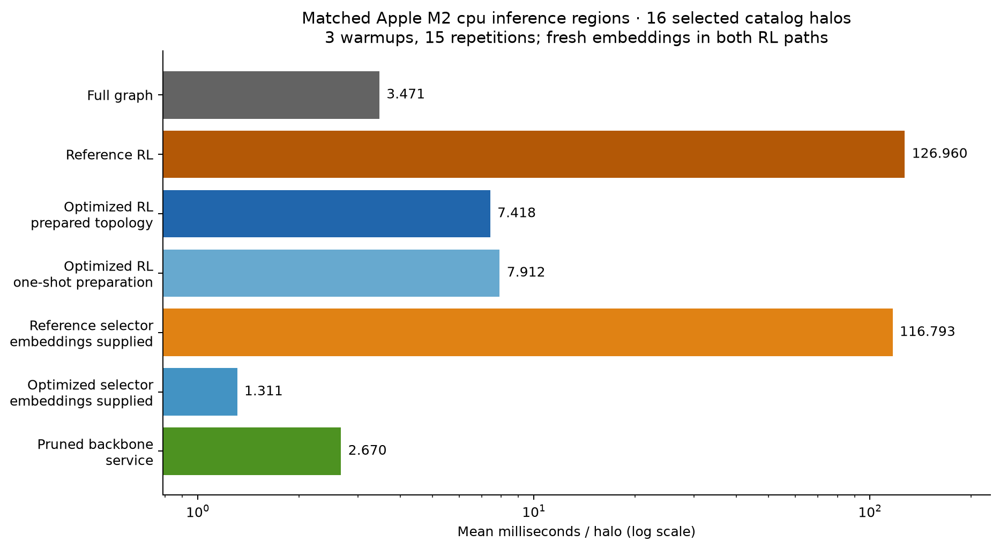
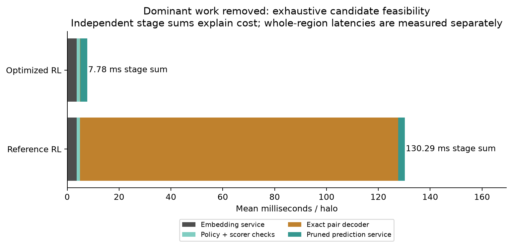
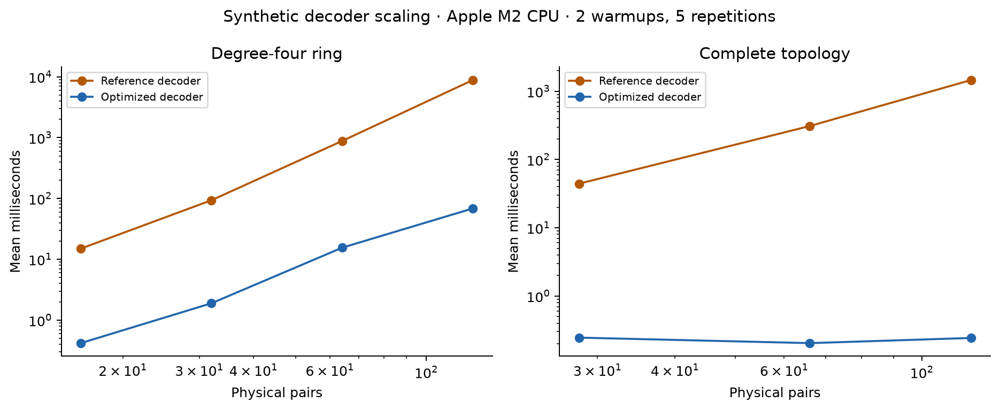

# RL inference efficiency audit

## Result and scope

On this matched Apple M2 CPU experiment, the existing RL inference region averaged **126.960 ms/halo**, the opt-in optimized region **7.418 ms/halo** (17.12× faster relative to existing RL), and optimized RL including fresh topology preparation **7.912 ms/halo** (16.05× faster relative to existing RL). The unchanged full-graph service averaged **3.471 ms/halo**. Optimized one-shot RL remains **2.28× slower than full graph**. There is no measured full-graph inference speedup.

These are directly timed inference regions on resident graphs, excluding common feature generation and initial input transfer. The one-shot variant includes a fresh topology cache in every call. No change is installed into the historical benchmark, notebooks or training path: the new decoder is opt-in. The completed scientific benchmark and its conclusions remain unchanged.

The user-supplied historical values, 0.00784 s full graph and 0.440 s RL (56.12× ratio), are historical context only. They are not combined with laptop timings or used as a hardware-matched baseline. No claim is made to reproduce their absolute latency or hardware. This study uses the frozen backbone from the completed campaign, not its separately fine-tuned Stage B backbone.

## Inputs and measurement

- Base commit: `c825bf57652005c80faff79cf4dfd58e3a9baa14`; original source modules remain unchanged.
- Hardware: Apple M2, 8 GiB unified memory; device CPU. Python 3.13.3, PyTorch 2.13.0, PyG 2.8.0.post1, NetworkX 3.6.1. One intra-op and one inter-op thread. This differs from the historical pinned training environment.
- The local legacy clustered catalog, backbone and copied completed policy are SHA256-checked against the campaign manifest. The policy is not retrained. The original catalog's radius/target semantics remain uncertified; these are available catalog graphs, not a newly validated astrophysical population.
- All 82 campaign test IDs were considered; 82 are feasible at 40%. The 16 timed IDs span the feasible population sorted by (node count, stored edges, ID). No labels or prediction quality affect membership. The average realized retention is 40.340% because budgets use ceil(0.4P).
- These graphs have 7–10 nodes and 21–45 physical pairs. Averages describe this declared subset, not an estimate over all test halos. Larger topologies below are explicitly synthetic.
- 3 warmups and 15 repetitions per graph/region; method order shuffled with a fixed seed for every repetition. `perf_counter_ns` measures wall time. The harness synchronizes CUDA/MPS before/after a region when explicitly requested; CPU work is synchronous. Included results are CPU only.
- Models use eval mode and no gradients. Both RL paths obtain fresh full-backbone embeddings and execute the same two-orientation policy scorer on every call. The original scorer, prediction service, float32 score conversion and fixed per-graph marks are shared. Model and policy state hashes are unchanged after timing.
- Whole inference regions are timed directly. Stage measurements are separate; their sums are explanatory approximations, not a claimed end-to-end measurement. Service latencies include checks, cloning, Batch construction and state preservation. Bare forwards use already built batches. No application I/O, scheduling, networking, training, TTA or MC uncertainty runtime is claimed.

## Prediction-path audit

| Operation | Existing operation and cost boundary |
| --- | --- |
| Catalog / features | `TNGLoader.load` parses CSV, converts declared units, groups halos; `HaloData.get_node_features` computes log features. `GraphBuilder.build_graph` computes radius neighbors via chunked cdist, symmetry/coalescing, loops, nearest-neighbor fallback, distances, velocity differences, angle, signed mass ratio and projected separation. Per-halo graph construction is measured separately. |
| Physical layout / fixed marks | `PhysicalPairLayout.from_edge_index` validates endpoints, separates loops, sorts endpoints and unique-reduces stored copies. `fixed_marks` hashes seed/graph identity and creates a replayable permutation. The historical matched evaluator prepares these outside its inference region. |
| Full-backbone embedding | `PairScorer._score_provided_rl` calls `MeteredPredictor.call(return_embeddings=True)`: validates/clones graph, builds Batch, sets eval mode, executes the entire full GNN and prediction head, validates results and restores modes/buffers. This is required before pruning and is charged in both RL regions. |
| Policy execution | Mean-pool node embeddings for context; clone/reverse edge attributes and endpoints; negate signed mass-ratio feature; run EdgePolicyNet twice; average orientations. Policy projections currently repeat endpoint projections per stored edge. This path is intentionally unchanged to preserve logits and numerical ranking. |
| Pair score reduction | Average all real stored copies through the inverse map using index_add, then validate finite logits and convert to float32. Scorer validation reconstructs/alignment-checks layout and hashes the policy state per call. The cached-embedding scorer timing includes this provenance/check overhead. |
| Action selection / sampling | Primary inference is deterministic direct ranking with unique independent pair marks for ties. It performs no categorical sampling and evaluates no likelihood. Training/legacy pair PL and TTA can loop over multinomial draws and construct ordered likelihood arrays; those paths are audited but not optimized or timed here. |
| Exact physical-pair decoding | Original `select_pairs` calls `_candidates` at each of k steps, testing every remaining proposal. Each feasibility test reconstructs full/chosen CPU NetworkX graphs and solves edge-cover completion through maximum matching of uncovered nodes. |
| Constraint repair | Exact direct inference enforces no-isolate completion during selection; there is no additive post-repair. Infeasible requests raise. Legacy `repair_pairs` walks pair marks, adding incident pairs and potentially exceeding the requested count; replacing exact selection with it would change the experiment and is not done. |
| Reconstruction | `MeteredPredictor` validates mask, clones Data (including detached copies of x/edges/attrs), physically slices edge_index and edge_attr in original column order, then calls Batch.from_data_list. Extra metadata tensors are cloned too. This service is unchanged and is measured separately from its bare forward. |
| Pruned GNN | Same frozen NNConv backbone and prediction head, unchanged nodes/features/weights, fewer stored edges; all selected reciprocal/duplicate columns and architecture self-loops remain. |
| Transfers / synchronization | Original feasibility repeatedly uses tensor scalar extraction and `.cpu().tolist()` and rebuilds CPU graphs. Scorer policy-state hashing also stages tensor data to CPU on accelerators; original evaluator additionally moves selected/mask diagnostics to CPU then the mask back to the model device. The optimized decoder copies endpoints once during preparation, transfers one ranked vector per decode and final order/membership to its device, and still uses the original diagnostic expansion. CPU runs make no GPU transfers. Accelerator behavior is not measured here. |

## Dominant bottleneck and safe optimization

The initial independent small-graph cProfile (10 nodes, 19 pairs) recorded 125 feasibility/matching calls, 251 NetworkX graph constructions, and about 97% of instrumented decoder time under candidate feasibility. The representative matched decoder profiles in the raw results show the same issue on the trained policy. Profiled wall times include instrumentation and are not used in latency tables.

`PreparedTopology` owns a cloned physical layout, a frozen CPU graph, immutable endpoint tuples and the exact minimum edge-cover size. One full matching is charged to preparation. It caches no embeddings, scores, masks or model-dependent values. Rebuild it if topology, column order, node count or device changes; treat its fields as read-only.

`select_pairs_fast` sorts by the same score and mark tie priorities once and lazily tests candidates in that order. For uncovered nodes U and r remaining slots, |U| <= r guarantees completion because each uncovered node has an incident original edge; ceil(|U|/2) > r proves impossibility. Ambiguous cases use the same exact formula |U| - maximum_matching(G[U]) <= r. A rejected candidate cannot become feasible after extending the prefix: any later completion containing it would also complete the earlier prefix. Thus candidates are visited once without changing the reference greedy action. `none` uses vectorized ranking; `connected` delegates to the reference. Sampling/scaffold/training semantics are not changed.

Final diagnostics and stored-column expansion use the existing implementation. No top-k approximation, budget expansion, invented reverse edge, deleted loop, isolate tolerance or backbone approximation is introduced. The scorer still repeats layout validation; preparation only removes repeated topology construction from decoder feasibility.

## Matched latency

Milliseconds per halo; median and p95 pool the 240 measured samples, with equal samples per selected graph. Source JSON preserves individual samples and per-graph values.

| Region | Mean ms | Median ms | p95 ms |
| --- | ---: | ---: | ---: |
| full_graph | 3.4708 | 3.3358 | 4.0348 |
| reference_rl | 126.9602 | 129.1477 | 154.0882 |
| optimized_rl | 7.4179 | 7.4295 | 9.6036 |
| optimized_rl_one_shot | 7.9122 | 7.9224 | 9.7019 |
| reference_selector_no_embedding | 116.7926 | 122.2147 | 150.2219 |
| optimized_selector_no_embedding | 1.3106 | 1.2716 | 1.6282 |
| pruned_backbone_service | 2.6695 | 2.6772 | 3.2957 |
| pair_layout | 0.2478 | 0.2411 | 0.3311 |
| topology_preparation | 0.5050 | 0.4966 | 0.6216 |
| embedding_service | 3.6094 | 3.4795 | 4.4838 |
| embedding_forward | 2.0179 | 1.9030 | 2.3314 |
| policy_and_pair_reduction | 1.2732 | 1.1539 | 1.6733 |
| policy_two_orientations | 0.4966 | 0.4666 | 0.6641 |
| physical_pair_score_reduction | 0.0407 | 0.0360 | 0.0607 |
| reference_decoder | 122.7339 | 123.0362 | 155.1321 |
| optimized_decoder | 0.2265 | 0.1907 | 0.3148 |
| graph_reconstruction | 1.0066 | 0.9110 | 1.1892 |
| full_backbone_forward | 1.9375 | 1.9137 | 2.4211 |
| pruned_backbone_forward | 1.2808 | 1.2339 | 1.7036 |
| input_to_device | 0.2054 | 0.1987 | 0.2597 |
| resident_input_clone | 0.1108 | 0.1065 | 0.1386 |
| output_to_host | 0.0025 | 0.0023 | 0.0036 |
| feature_generation | 0.3137 | 0.3211 | 0.3622 |

Selector-only regions explicitly assume supplied embeddings. They are not complete RL prediction timings. Input transfer measures cloning from a retained CPU graph followed by `.to(device)`; on this CPU run it is a host clone and a no-op device conversion. Output-to-host is a no-op CPU conversion. Common feature generation and initial transfers can be added to either pipeline, but an actual fresh-catalog application wall-time speedup has not been measured.

## Scaling

The genuine available catalog spans only 7–10 nodes; it cannot establish large-graph scaling. Synthetic degree-four rings hold degree constant as N grows; complete graphs increase density. Features are synthetic, topology and family are explicit, and both methods use the same trained policy/backbone and 40% exact budget. 2 warmups and 5 repetitions per region on the same Apple M2 CPU; no scientific accuracy claim. Preparation is separate from the prepared-topology optimized region.

| Synthetic family | N | P | Reference decode mean (median) ms | Optimized decode mean (median) ms | Full service ms | Reference RL ms | Optimized RL ms |
| --- | ---: | ---: | ---: | ---: | ---: | ---: | ---: |
| ring_degree_4 | 8 | 16 | 14.9975 (15.0790) | 0.4192 (0.3892) | 1.9790 | 39.0889 | 5.1138 |
| ring_degree_4 | 16 | 32 | 93.5779 (92.7329) | 1.8948 (1.8290) | 2.5291 | 99.0792 | 7.9485 |
| ring_degree_4 | 32 | 64 | 881.1961 (882.3537) | 15.5201 (15.3948) | 3.7363 | 890.9602 | 25.4492 |
| ring_degree_4 | 64 | 128 | 8831.5319 (8255.2272) | 68.5406 (68.3088) | 6.1021 | 8182.3671 | 80.7248 |
| complete | 8 | 28 | 44.2376 (44.1790) | 0.2455 (0.2493) | 2.2411 | 49.5879 | 5.6045 |
| complete | 12 | 66 | 309.6779 (309.9695) | 0.2040 (0.2085) | 3.3014 | 317.4783 | 7.5801 |
| complete | 16 | 120 | 1458.9574 (1467.5521) | 0.2427 (0.2331) | 4.8166 | 1505.5487 | 9.9773 |

All samples, including scheduling/GC outliers, are retained. This is a live machine without CPU affinity or thermal isolation, and scaling uses only 5 repetitions. Independent stage samples can consequently have a larger mean than a separately timed whole region; they must not be subtracted as if they were simultaneous measurements. Decode medians above expose this variation; full raw samples are included.

Reference candidate enumeration performs about kP feasibility tests and repeatedly builds graphs. Optimized ranking is O(P log P), checks at most P proposals, and still has worst-case expensive matching fallbacks. This is not a claim of linear-time general matching or scaling to production-sized astronomical graphs. Dense NNConv can also become the dominant native-memory and inference cost after decoder optimization.

## Memory

Mean Python allocation peak from separate tracemalloc runs, not mixed into latency:

| Region | Peak KiB |
| --- | ---: |
| full_graph | 32.5 |
| reference_rl | 550.6 |
| optimized_rl | 78.3 |
| optimized_rl_one_shot | 92.4 |
| reference_selector_no_embedding | 518.5 |
| optimized_selector_no_embedding | 71.5 |
| pruned_backbone_service | 32.7 |

Process maximum resident set was 388.0 MiB for the complete process, including imports, models and all regions. Mean owned cache tensor storage is 1457 bytes plus Python endpoint/NetworkX storage; topology-preparation Python peaks are in the raw JSON. These are not native CPU tensor allocation peaks or per-method RSS attribution. CUDA peak allocation and MPS live allocation support exist in the harness but are not reported as measured results here.

## Regression evidence and limitations

The regression suite covers all 64 simple four-node topologies at every possible budget, mixed score ties and explicit marks; random larger topologies; disconnected, one-way, duplicate, loop-only and empty layouts; unrepresented input isolates; infeasible and malformed budgets; nonfinite scores; source mutation; RNG preservation with explicit marks; transported relabeling/column permutation; connected fallback; and identical predictions from a real small CosmicNetGNN. The exact edge-cover path where the highest logit would make the requested budget infeasible has a literal regression case. All 82 campaign test graphs were also replayed: masks, ordered actions, diagnostics and CPU predictions were identical; maximum prediction difference was zero.

The pre-change suite passed 804 tests with 13 skipped. The final suite passed **820 tests with 13 skipped**; exact command output is saved in `benchmarks/paper_efficiency/results/tests.txt`. Dependency deprecations and availability skips remain visible. The final run took 195.69 seconds, including a slow shared Git history read in the unchanged archival-notebook test; no test was skipped or altered to work around it. The independent review found no decoder correctness issue; its transfer-timing finding was corrected before the final measured replay. A strict break-even floating-point boundary also received a failing regression and fix. The experiment manifest binds scaling to the main run's hardware, software, inputs and source hashes.

Limitations: one laptop CPU; small legacy graphs and a declared timing subset; no Kaggle/CUDA timing reproduction; no accelerator throughput, batched throughput, TTA or MC-dropout benchmark; Python-only allocation peaks; no population confidence interval from this stratified sample. Optimized RL still requires a full embedding forward before pruned prediction. See `inference-cost-model.md` for conditional reuse assumptions, rather than a deployment-speedup claim.

## Reproduction

See `benchmarks/paper_efficiency/README.md` for complete commands, input hashes, scopes, cache invalidation and opt-in API usage. Raw results, per-graph samples, environment, source identities, profiles and copied policy are versioned under `benchmarks/paper_efficiency/`. PNG and editable SVG figures are in `paper/figures/efficiency/`. No original scientific evidence file is overwritten.
