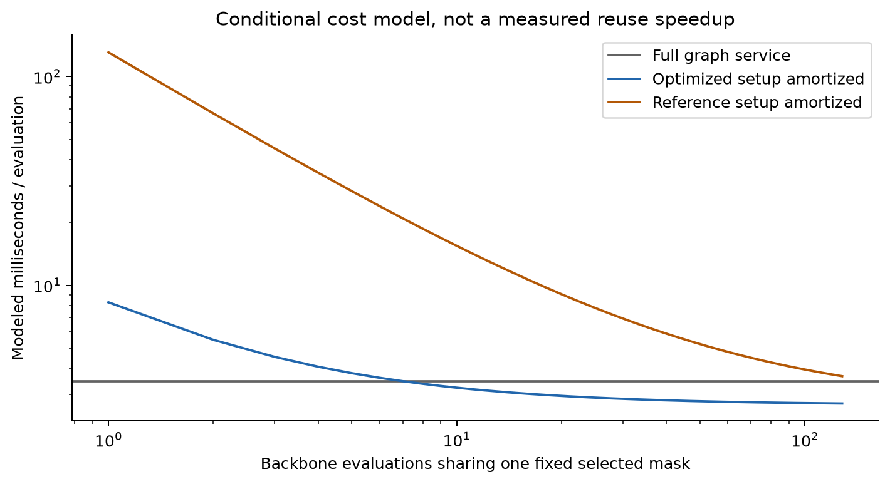

# Inference cost model

## Measured starting point

All coefficients come from the same Apple M2 CPU experiment in `efficiency-analysis.md`. Do not substitute the historical 0.00784 s / 0.440 s numbers into this model as matched machine coefficients. The backbone is frozen and topology, feature definitions, policy and exact 40% pair budgets are unchanged.

Let F be full-graph prediction service cost, B selected-graph prediction service cost, E full-backbone embedding service, L policy scoring plus validation/provenance and pair reduction, D exact decoding, and C topology preparation. Services include graph cloning/Batch construction and state checks. Common feature construction H is outside the inference region.

Measured F = **3.4708 ms**, B = **2.6695 ms**. Pruned bare forward averages 1.2808 ms versus full bare forward 1.9375 ms; those bare-forward timings cannot replace service costs in an end-to-end comparison.

One-shot RL is approximately C + E + L + D + B. Directly measured optimized one-shot RL is **7.9122 ms**; summing independent stages gives **8.2836 ms**. The difference is ordinary independent-region timing variation and wrapper boundaries; the direct timing is the performance result. Since E already requires the full graph and B > 0, reducing D cannot by itself make this pipeline cheaper than a single full prediction under these measurements.

## What can be amortized

Catalog parsing/model loading are one-time process costs: this run measured 0.1939 s catalog loading and 0.0323 s model loading/device initialization. They are not inference speedups. Feature generation averages **0.3137 ms/halo** on warmed builds. Its first-build timings for all test graphs are retained separately. Both methods require the full raw graph, so adding H to both cannot turn a slower one-shot RL method into a faster one.

Topology preparation averages **0.5050 ms/halo** and can be reused while edges, node count, column order and device remain fixed. This is the implemented cache. It remains valid when logits change, but embeddings/policy scoring/decoding must then be recomputed. Reusing only topology approaches the measured prepared RL region (7.4179 ms); it never removes the required embedding pass and remains slower than full graph (3.4708 ms).

Full embeddings can only be reused when node/edge features, full topology, backbone weights/mode and any stochastic realization are unchanged. A policy update or changed features requires rescoring and can change selection. A changed backbone generally invalidates embeddings. Masks can be reused only when doing so is an explicit valid inference contract; this study does not silently reuse masks across scientific examples or augmentation/MC draws.

## Conditional fixed-mask reuse scenario

Suppose a valid application needs R backbone evaluations sharing one selected mask, frozen embeddings/scoring inputs and the same predictor contract. Charge S = C + E + L + D once and B per evaluation:

`T_full(R) = R F`

`T_RL(R) = S + R B`

`T_RL(R) < T_full(R)` requires `F > B` and `R > S / (F - B)`.

The optimized setup coefficient S is **5.6141 ms** and the original setup coefficient is **127.8643 ms**. On aggregate mean coefficients, strict break-even is **R = 8** optimized, versus **R = 160** reference. Per selected graph, 16 of 16 have positive measured B savings; finite thresholds span 2–39. These thresholds are a cost-model calculation from small measured differences, not a measured reuse speedup or population guarantee. All coefficients and per-graph thresholds are in `inference-cost-model.json`.

| R shared evaluations | Full total ms, modeled | Optimized total ms, modeled | Reference total ms, modeled |
| --- | ---: | ---: | ---: |
| 1 | 3.471 | 8.284 | 130.534 |
| 2 | 6.942 | 10.953 | 133.203 |
| 4 | 13.883 | 16.292 | 138.542 |
| 8 | 27.766 | 26.970 | 149.221 |
| 16 | 55.533 | 48.327 | 170.577 |
| 32 | 111.065 | 91.039 | 213.289 |
| 64 | 222.130 | 176.465 | 298.715 |
| 128 | 444.261 | 347.315 | 469.565 |

If the same deterministic query is repeated with identical inputs and models, caching the full prediction is cheaper than repeatedly running either backbone. The R scenario is useful only when separate backbone evaluations are actually necessary and a fixed selector/mask is valid. Fixed-mask MC uncertainty, repeated heads or compatible ensembles could motivate a separate experiment, but none is validated or timed here. Different weights, stochastic selector embeddings, augmentation or changed observations can invalidate reuse; recomputing the full selector each time removes this amortization opportunity.

If B >= F on a different graph/device, no finite R breaks even. If S must be paid per independent halo (the normal one-shot case), increasing the number of distinct halos does not amortize it. Batching may improve utilization but must be measured with equal batch sizes and complete selector/transfer costs. Training, adaptation, policy preparation and cache storage/invalidation would add further costs and have not been amortized away.

## Practical conclusion

The measured optimization removes the dominant repeated CPU feasibility computation. It substantially improves existing RL inference, but the completed benchmark should continue to report RL pruning as a cost/accuracy tradeoff. This study supplies no measured single-halo speed advantage over full-graph prediction and no validated repeated-use deployment advantage.
